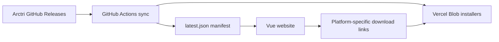

<div align="center">
  

  # Arctri Website
  **The official landing and download experience for an AI agent-first terminal.**

  [](https://vuejs.org/)
  [](https://www.typescriptlang.org/)
  [](https://tailwindcss.com/)
  [](https://vite.dev/)

  [Website Repository](https://github.com/7sadakonr/WebPageArctri) · [Arctri Application](https://github.com/7sadakonr/Arctri) · [App Releases](https://github.com/7sadakonr/Arctri/releases)
</div>

## Overview

**Arctri Website** is a responsive marketing and download website for [Arctri](https://github.com/7sadakonr/Arctri), a terminal designed around AI coding-agent workflows. Built with **Vue 3, TypeScript, Vite, and Tailwind CSS**, the site presents the product, demonstrates its UI, and serves platform-specific installers.

> This repository contains **the website**, not the Arctri desktop terminal's application source code.

## Features

- **Product landing page** with hero, feature grid, agent overview, FAQ, and download section.
- **Interactive terminal mockup** demonstrating the product interface.
- **Bilingual content** in English and Thai using Vue I18n.
- **Platform-specific downloads** for Windows x64, macOS Apple Silicon, and macOS Intel when builds are available.
- **Release manifest** to display the current downloadable version and installer URLs.
- **Automated release sync** through GitHub Actions and Vercel Blob storage.
- **Responsive layout** built with Tailwind CSS.

## Tech Stack

| Technology | Usage |
| --- | --- |
| Vue 3 | Component-based interface |
| TypeScript | Typed application logic |
| Vite 8 | Development and production build |
| Tailwind CSS 4 | Styling and responsive layout |
| Vue I18n | English and Thai localization |
| Lucide Vue Next | Icons |
| Vercel Blob | Installer files and release manifest |
| GitHub Actions | Automated release synchronization |

## Architecture



The site reads a `latest.json` manifest from the URL configured in `src/config.ts` or `VITE_MANIFEST_URL`. A download link appears only when the manifest includes that platform's installer.

## Local Development

**Requirements:** Node.js compatible with Vite 8 and npm.

```bash
git clone https://github.com/7sadakonr/WebPageArctri.git
cd WebPageArctri
npm install
npm run dev
```

### Production Build

```bash
npm run build      # Vue type-check + Vite build
npm run preview    # Preview production build
```

Output: `dist/`.

### Optional Download Manifest Override

Set a custom release manifest URL in `.env.local` if you use a different Blob store:

```env
VITE_MANIFEST_URL=https://your-public-blob-store.example/latest.json
```

## Release Publishing

The repository includes two complementary release paths:

1. **GitHub Actions:** `.github/workflows/sync-release.yml` checks for Arctri releases on a scheduled basis and supports manual or repository-dispatch triggers. It uses `scripts/sync-release.mjs` and the `BLOB_READ_WRITE_TOKEN` repository secret.
2. **Manual publish:** `scripts/publish-release.mjs` uploads installer files to Vercel Blob and updates `latest.json`.

Example manual publish:

```bash
npm run publish-release -- --version 0.3.0-beta \
  --win ./dist/Arctri-Setup.exe \
  --mac-arm ./dist/Arctri-arm64.dmg \
  --mac-intel ./dist/Arctri-x64.dmg
```

File paths above are **examples**: provide the actual installer paths. Set `BLOB_READ_WRITE_TOKEN` in your private local environment before running the command. The manual publish script removes older release blobs after publishing a new manifest, so use it only when you intend to replace the current downloads.

## Project Structure

```text
WebPageArctri/
├── src/
│   ├── components/           # Landing page and terminal mockup
│   ├── composables/          # Latest release and OS detection
│   ├── i18n/                 # English / Thai translations
│   ├── config.ts             # Repository and manifest configuration
│   └── App.vue               # Page composition
├── public/                   # Branding assets
├── scripts/                  # Release publish/sync utilities
├── .github/workflows/        # Release synchronization workflow
└── vite.config.ts            # Vite configuration
```

## Deployment

Build and deploy the `dist/` folder to Vercel or another static host. Ensure the website can read the public manifest and that the release synchronization workflow has the required secret. **Never put the Blob write token in `VITE_*` frontend variables.**

## License

See the [LICENSE](LICENSE) file.

---

<div align="center">Part of the <a href="https://github.com/7sadakonr/Arctri">Arctri</a> project.</div>
